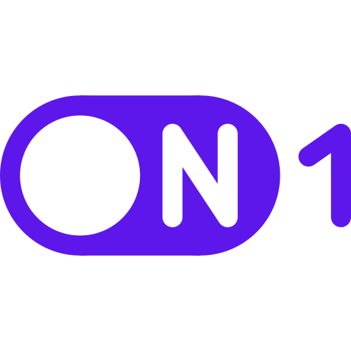

<h1 align="center">On-By-One</h1>
<h2>📖 Documentazione 📖</h2>

Questa repository ospita i sorgenti della documentazione del gruppo <strong>On-By-One</strong> (Gruppo 1) del primo lotto del corso di Ingegneria del Software.

A.A. 2026/27, Università degli Studi di Padova.

<h2>Consultazione dei documenti</h2>

I nostri documenti possono essere consultati tramite il nostro <a href="https://on-by-one-team.github.io/On-By-One.github.io/">sito internet</a>.

<h2>📩 Contattaci 📩</h2>
Puoi contattarci all'indirizzo email <a href="mailto:onbyone.swe@gmail.com">onbyone.swe@gmail.com</a>

<h2>👤 Componenti del gruppo 👤</h2>
<table>
  <tr>
    <th>Nome</th>
    <th>Matricola</th>
    <th>Email</th>
  </tr>
  <tr>
    <td>Sara Ballardin</td>
    <td align="center">2101048</td>
    <td><a href="mailto:sara.ballardin.1@studenti.unipd.it">sara.ballardin.1@studenti.unipd.it</a></td>
  </tr>
  <tr>
    <td>Shuhui Chen</td>
    <td align="center">2138001</td>
    <td><a href="mailto:shuhui.chen@studenti.unipd.it">shuhui.chen@studenti.unipd.it</a></td>
  </tr>
  <tr>
    <td>Simone Giuliano</td>
    <td align="center">2145591</td>
    <td><a href="mailto:simone.giuliano@studenti.unipd.it">simone.giuliano@studenti.unipd.it</a></td>
  </tr>
  <tr>
    <td>Alvise Greggio</td>
    <td align="center">2141004</td>
    <td><a href="mailto:alvise.greggio@studenti.unipd.it">alvise.greggio@studenti.unipd.it</a></td>
  </tr>
  <tr>
    <td>Daniele Nuzzaci</td>
    <td align="center">2139039</td>
    <td><a href="mailto:daniele.nuzzaci@studenti.unipd.it">daniele.nuzzaci@studenti.unipd.it</a></td>
  </tr>
  <tr>
    <td>Federico Temporin Chen</td>
    <td align="center">2146764</td>
    <td><a href="mailto:federico.temporin.1@studenti.unipd.it">federico.temporin.1@studenti.unipd.it</a></td>
  </tr>
  <tr>
    <td>Tommaso Zorzetto</td>
    <td align="center">2148629</td>
    <td><a href="mailto:tommaso.zorzetto@studenti.unipd.it">tommaso.zorzetto@studenti.unipd.it</a></td>
  </tr>
</table>

<strong>© 2026 OnByOne. Tutti i diritti riservati.</strong>

